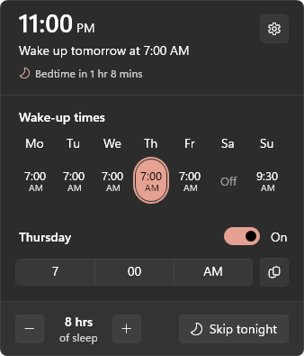
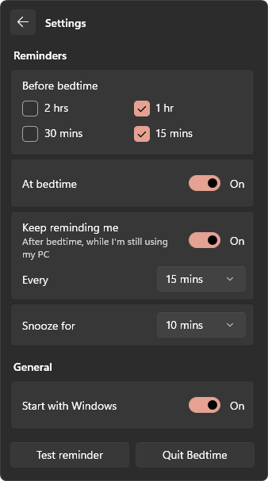

# Bedtime

**A Windows 11 tray app that tells you when to go to bed.** Set the time you need to wake up each day and how
much sleep you want. Bedtime works out your bedtime and reminds you with native Windows notifications as it
gets close.

<p align="center">
  
  &nbsp;&nbsp;
  
</p>

Bedtime lives next to the clock and opens like the taskbar's own Calendar flyout: same width and position,
acrylic background, your accent colour, and light or dark to match the taskbar.

## Features

- **A wake-up time for each day of the week**, or none for days you can sleep in. Copy a time to weekdays, the
  weekend or every day.
- **Bedtime = wake-up time − sleep goal.** It's calculated on real elapsed time, so the nights the clocks change
  still give you the full amount.
- **Reminders as native Windows notifications:**
  - heads-ups before bedtime (choose 2 hrs, 1 hr, 30 mins or 15 mins; 1 hr and 15 mins by default),
  - one at bedtime,
  - then "Still up?" every 15 mins, only while you're actually using the PC.
- **Snooze** or **Going to bed** straight from the notification, and **Skip tonight** from the panel or the tray
  menu.
- The bedtime and "Still up?" notifications stay on screen until you act on them, and can get through
  Do Not Disturb.
- Starts with Windows and stays out of the way: the tray tooltip shows how long until bedtime. Reminders missed
  while the PC was asleep aren't replayed hours later.

## Install

1. Download **`Bedtime-<version>-win-x64.zip`** from the
   [latest release](https://github.com/SpeedyNabz/bedtime/releases/latest) and extract it.
2. Right-click **`install.ps1`** and choose **Run with PowerShell**.

That's it: Bedtime opens its panel so you can set your wake-up times. It installs for your account only (no
administrator rights) to `%LOCALAPPDATA%\Programs\Bedtime`, adds a Start menu shortcut, starts when you sign in,
and is listed in Settings › Apps. Run a newer release's `install.ps1` to update; your settings are kept.

Bedtime needs Windows 11 (x64) and Microsoft's
[Windows App Runtime 2.5](https://learn.microsoft.com/windows/apps/windows-app-sdk/downloads), which many PCs
already have. If yours doesn't, the installer offers to download it from Microsoft. The zip includes everything
else, including .NET.

### Build from source

Needs the [.NET 10 SDK](https://dotnet.microsoft.com/download/dotnet/10.0).

```powershell
git clone https://github.com/SpeedyNabz/bedtime.git
cd bedtime
.\install.ps1
```

Run it from a normal PowerShell window, not "Run as administrator", because Windows doesn't show notifications
from elevated apps. If scripts are blocked, use `powershell -ExecutionPolicy Bypass -File .\install.ps1`.

## Using Bedtime

- **Click the moon** next to the clock to open the panel. It shows tonight's bedtime, when you're up, and how long
  until bedtime. Click anywhere else, or press Esc, to close it.
- **Wake-up times:** click a day to edit it or switch it off. The highlighted day is the one tonight's bedtime is
  for.
- **− / +** sets your sleep goal in 30-minute steps.
- **Skip tonight** mutes reminders until your next wake-up.
- **⚙** opens Settings: which reminders you get, snooze length, start with Windows, a test reminder, and Quit.
- **Right-click the moon** for Open, Skip tonight, Settings and Quit.

### Do Not Disturb

Windows holds back notifications while Do Not Disturb is on, and it turns that on automatically while you play a
game or use a full-screen app. Bedtime's bedtime and "Still up?" notifications are sent as *reminders*, so they
still appear if you turn on **Settings › System › Notifications › Set priority notifications ›
Show reminders, even when do not disturb is on**.

## Uninstall

Settings › Apps › Installed apps › Bedtime › Uninstall, or run `.\uninstall.ps1` (add `-KeepSettings` to keep
your wake-up times).

## How it works

| Part | What it does |
| --- | --- |
| [`src/Bedtime.Core`](src/Bedtime.Core) | Settings, the night planner, the reminder engine and all user-facing wording. No UI, and fully unit-tested, including clock changes. |
| [`src/Bedtime`](src/Bedtime) | The app, using WinUI 3 on the Windows App SDK 2.5 (unpackaged). |
| [`Services/TrayIcon.cs`](src/Bedtime/Services/TrayIcon.cs) | The notification-area icon, built directly on `Shell_NotifyIcon` with no tray library. Its right-click menu follows the taskbar's light/dark mode. |
| [`FlyoutWindow.xaml.cs`](src/Bedtime/FlyoutWindow.xaml.cs) | The panel: a borderless window with an acrylic backdrop and rounded corners. It sizes to its content, sits above the taskbar on the monitor you're using, and closes when another app comes to the front. |
| [`Services/NotificationService.cs`](src/Bedtime/Services/NotificationService.cs) | Notifications through `AppNotificationManager`, with Snooze and Going to bed buttons. |
| [`Services/ReminderScheduler.cs`](src/Bedtime/Services/ReminderScheduler.cs) | Checks the wall clock every 20 seconds, so sleep/resume and clock changes need no special handling. |

Settings and a small log live in `%LOCALAPPDATA%\Bedtime` (`settings.json`, `bedtime.log`). Command-line
options: `--background` (start hidden), `--test-toast` and `--quit`.

## Development

```powershell
dotnet test tests\Bedtime.Core.Tests   # planner, reminder engine, wording, settings
dotnet build src\Bedtime               # the app (x64)
```

- `tools/package.ps1` builds the release zip (the app with its own copy of .NET, plus the install scripts).
- `tools/make-icons.ps1` regenerates the icons from the Segoe Fluent Icons font.
- Set `BEDTIME_DATA_DIR` to run a copy against a different settings folder. Windows allows one running copy per
  exe path, so a dev build and the installed app can run side by side.

## License

[MIT](LICENSE)
